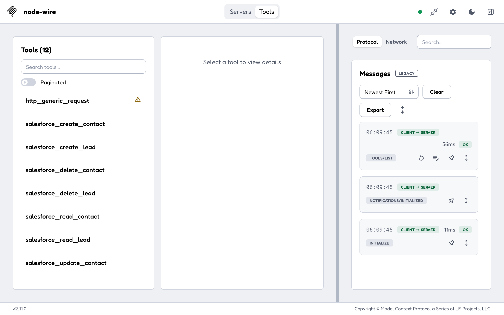
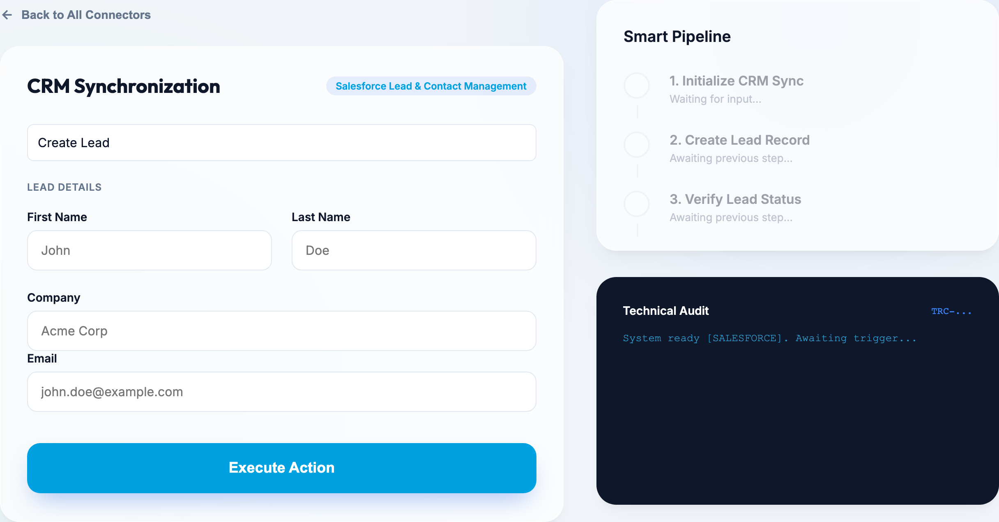
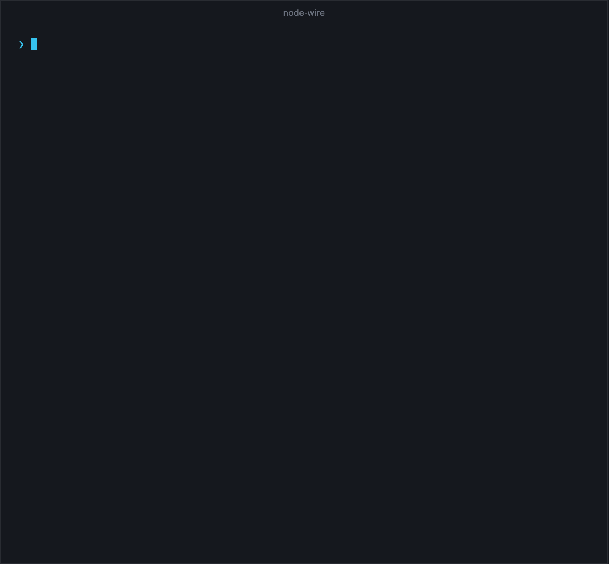
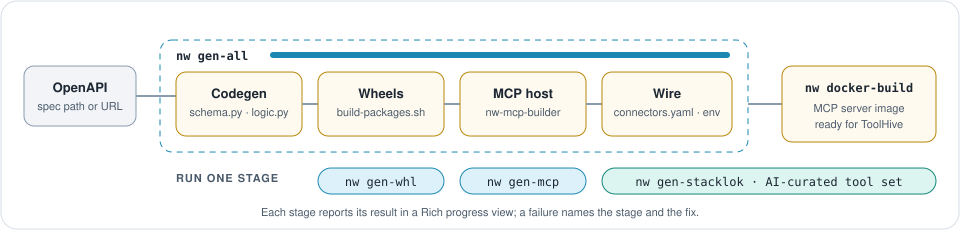

<!--
SPDX-FileCopyrightText: 2026 AOT Technologies

SPDX-License-Identifier: Apache-2.0
-->

# node wire

[](https://github.com/AOT-Technologies/node-wire/actions/workflows/pytest.yml)
[](https://github.com/AOT-Technologies/node-wire/actions/workflows/codeql.yml)
[](https://pypi.org/project/node-wire-runtime/)
[](https://github.com/AOT-Technologies/node-wire/releases/latest)
[](LICENSE)

<p align="center">
  
</p>

<p align="center">
  
</p>

**node wire is an open-source connector framework that gives organizations
control over how enterprise systems connect to business workflows and AI
agents.** Build a connector once and expose it over REST for process
automation, Model Context Protocol (MCP) for AI agents, or gRPC, all without
depending on an externally hosted integration platform. Deploy on premises, in
a private cloud or in sovereign cloud infrastructure, and keep the freedom to
choose your workflow engines and AI frameworks. OpenAPI-based connector and MCP
generation, tenant-specific configuration and a shared runtime with built-in
validation, resilience and telemetry reduce integration effort.

Each connector is an adapter for one external system: Google Drive, SMTP,
Stripe, FHIR, Salesforce, Slack, or any HTTP API with an OpenAPI spec. The
runtime gives every action one execution contract and one response envelope, so
a failure from Stripe and a failure from Salesforce reach the caller with the
same shape and the same error categories.

The `nw` CLI turns an OpenAPI or Swagger spec into a connector, Python wheels
and an MCP server in one command, and `nw docker-build` packages that server as
a Docker image. Tenancy is built in: each
tenant gets its own config and secrets, and an instance pinned to one tenant
can't act for another.

## What it provides

node wire gives every connector the following:

- One connector contract served over REST (FastAPI), gRPC and MCP (stdio and
  streamable HTTP), with no transport code in the connector.
- A `run()` pipeline on every action: tenant pin check, Pydantic validation,
  scope policy, retries with a circuit breaker, and error mapping, all inside an
  OpenTelemetry span.
- A stable error taxonomy: every failure carries an `error_code` and one of
  `RETRYABLE`, `BUSINESS`, `AUTH` or `FATAL`.
- Multi-tenancy with per-tenant named configs and secrets, resolved per request.
- MCP features for AI agents: tenant and config selection tools, scope policy,
  and a tool search mode for connectors with hundreds of tools.
- Code generation from OpenAPI and Swagger specs, plus `nw gen-stacklok` for
  ToolHive-ready MCP servers with an AI-curated tool set.
- Eight shipped connectors, published on PyPI as `node-wire-connectors`.

## Quick start

You need Python 3.11, 3.12 or 3.13 and [`uv`](https://docs.astral.sh/uv/). See [Installation](docs/installation.md) for everything else, including Windows commands. To start the REST API locally, run the following commands:

```bash
git clone https://github.com/AOT-Technologies/node-wire.git
cd node-wire
uv sync --frozen --extra agents --dev
cp sample.env .env                  # set NW_ALLOWED_CONNECTORS, for example http_generic
export NW_REST_AUTH_DISABLED=true   # local dev only — otherwise /connectors/* and /ready return 503 until auth is configured
MODE=API uv run node-wire
```

Open the [Swagger UI](http://localhost:8000/docs), or the [playground](http://localhost:8000/playground/) for interactive connector demos.

To install the packages instead of a source checkout, `pip install node-wire-connectors` installs the runtime and every public connector. See [Client consumption model](docs/packaging.md#client-consumption-model) for installing a subset.

## Where to go next

Pick the page that matches what you want to do:

| Goal | Start with |
|---|---|
| Turn an OpenAPI spec into an MCP server | [The `nw` CLI](#the-nw-cli) and the [CLI docs](docs/cli/index.md) |
| Call a shipped connector from Python or REST | [Use a connector](docs/connectors.md) |
| Write a connector by hand | [Build a connector](docs/connectors-build.md) |
| Give AI agents access to your connectors | [MCP overview](docs/mcp.md) |
| Serve many tenants from one deployment | [Tenancy](docs/architecture/tenancy.md) |

## Features

### Generate a connector from an OpenAPI spec

`nw gen-all` reads an OpenAPI 3 or Swagger 2 spec and writes a typed connector:
Pydantic input and output models for every operation, and one action per
operation. For example, the generated action for the Swagger Petstore
`findPetsByStatus` operation is the following:

```python
@nw_action("find_pets_by_status")
async def find_pets_by_status(
    self, params: FindPetsByStatusInput, *, trace_id: str
) -> FindPetsByStatusOutput:
    return await self.execute_rest(
        method="GET",
        path_template="/pet/findByStatus",
        params=params,
        output_model=FindPetsByStatusOutput,
        trace_id=trace_id,
        auth_scheme="petstore_auth",
    )
```

Generated code is never hand-edited: rerun the generator when the spec
changes. See [The `nw` CLI](#the-nw-cli) for the full pipeline.

### One contract, three transports

A connector declares actions; bindings expose each action as a REST route, an
MCP tool and a gRPC `Invoke` call. To serve the enabled connectors over each
transport, run one of the following commands:

```bash
MODE=API  uv run node-wire                          # REST on :8000
MODE=GRPC uv run node-wire                          # gRPC on :50051
NW_MCP_TRANSPORT=stdio uv run python -m agents.mcp_entrypoint   # MCP
```

The [MCP Inspector](docs/mcp.md#testing-with-mcp-inspector) lists every
connector enabled for MCP as a tool:

<p align="center">
  
</p>

### The same pipeline on every action

<p align="center">
  
</p>

Connectors implement only the outbound call. The runtime validates the
payload, applies the scope policy, retries transient failures behind a circuit
breaker, and maps every exception to a stable code, so callers get the same
`ConnectorResponse` envelope from every connector. A request with a bad method
and no URL returns the following response:

```json
{
  "success": false,
  "error_code": "VALIDATION_ERROR",
  "error_category": "BUSINESS",
  "message": "Input validation failed; please check the request payload.",
  "trace_id": "1fd692b8-59c6-4c64-ba1e-725f60d22d1e",
  "details": [
    {"loc": ["url"], "msg": "Field required", "type": "missing"},
    {"loc": ["method"], "msg": "Value error, method must be one of: DELETE, GET, PATCH, POST, PUT", "type": "value_error"}
  ]
}
```

Bindings translate `error_category` into an HTTP status, a gRPC code or an MCP
tool error. The [error reference](docs/errors.md) lists every code.

### Secure by default

Outbound calls fail closed. For example, `http_generic` refuses any host that
isn't on its egress allowlist, before any request leaves the process:

```json
{
  "success": false,
  "error_code": "SsrfBlockedError",
  "error_category": "FATAL",
  "message": "url host is not on the egress allowlist",
  "trace_id": "3703876f-6364-4fbf-83cb-3f1055d62b5e"
}
```

REST and MCP authentication are on unless you turn them off, and the MCP scope
policy decides which caller can see and call which tool. See
[Configuration](docs/configuration.md) for the `NW_*` settings.

### Multi-tenant from the start

<p align="center">
  
</p>

A tenant is entitled to a connector when it has a config for it. To entitle
`acme` and call the connector as that tenant, run the following commands:

```bash
curl -X POST localhost:8000/v1/connectors/http_generic/configs \
    -H 'X-Tenant-ID: acme' -H 'Content-Type: application/json' \
    -d '{"name": "default", "config": {}}'

curl -X POST localhost:8000/connectors/http_generic/request \
    -H 'X-Tenant-ID: acme' -H 'Content-Type: application/json' \
    -d '{"method": "GET", "url": "https://httpbin.org/get"}'
```

The same call with `X-Tenant-ID: initech` returns `403`. Over MCP, agents
switch tenants with the `nw_list_tenants` and `nw_select_tenant` tools. See
[Tenancy](docs/architecture/tenancy.md).

### Built for AI agents

The MCP binding adds features that matter when the caller is a model:

- **Tool search.** Set `NW_MCP_TOOL_MODE=search` and `tools/list` returns two
  tools, `nw_search_tools` and `nw_call_tool`, instead of hundreds. The listing
  stays around 1–2 KB whatever the connector size.
- **Three deployment paths.** Run one combined server, one container per
  connector, or a stacklok MCP server with an AI-curated tool set. See
  [Which MCP path?](docs/mcp.md#which-mcp-path).
- **Argument normalizers.** Connectors can map the aliases a model tends to
  use onto canonical fields before validation.

### Try connectors in the playground

The REST API ships a [playground](http://localhost:8000/playground/) with
interactive demos for the shipped connectors:

<p align="center">
  
</p>

## The `nw` CLI

`nw` turns an OpenAPI or Swagger spec into a runnable MCP server. It runs from
the repository root after the dev install in the [Quick start](#quick-start):

<p align="center">
  
</p>

`nw gen-all` chains every stage in one process, and each stage is also a
command of its own:

<p align="center">
  
</p>

The following table lists the commands:

| Command | What it does |
|---|---|
| `nw gen-all` | Connector codegen → Linux wheels → MCP host → wire into config |
| `nw gen-whl` | Build wheels only, through `scripts/build-packages.sh` |
| `nw gen-mcp` | Build the MCP host for an existing connector |
| `nw docker-build` | Build a Docker image from a generated MCP host |
| `nw gen-stacklok` | Build a stacklok MCP server, ToolHive-ready, from an AI-scoped spec |

To try the generator without registering anything, run `gen-all` on a copy of
the Swagger Petstore spec with an absolute `servers` URL:

```bash
uv run nw gen-all --connector-id petstore_demo --path petstore.json \
    --no-wheel --no-mcp --no-wire
```

The run generates all 19 Petstore operations and reports each stage:

<p align="center">
  
</p>

Drop the `--no-*` flags to build the wheels (Linux wheel builds need Docker),
the MCP host, and the config wiring as well. Read
[Trial run, or keeping the connector?](docs/cli/nw-cli.md#nw-gen-all) before
you run `gen-all` with wiring on. The [CLI docs](docs/cli/index.md) cover every
flag.

## Documentation

The full documentation is published at **[aot-technologies.github.io/node-wire](https://aot-technologies.github.io/node-wire/)** and lives in [`docs/`](docs/). Start with the following pages:

| I want to… | Read |
|---|---|
| Install, configure, run multi-tenant | [Installation](docs/installation.md) · [Configuration](docs/configuration.md) · [Tenancy](docs/architecture/tenancy.md) |
| Call a shipped connector | [Use a connector](docs/connectors.md) · [Connector catalog](docs/connector-reference.md#connector-catalog) |
| Build or generate a connector | [Build a connector](docs/connectors-build.md) · [CLI](docs/cli/index.md) |
| Deploy connectors as MCP servers | [MCP overview](docs/mcp.md) |
| Build wheels, MCP images, or run `docker-compose.mcp.yml` | [Packaging](docs/packaging.md) · [Local wheels → images](docs/local-packages-to-images.md) |
| Understand the codebase, in order | [Reading map](docs/reading.md) |

## Contributing

Contributions are welcome. Read [CONTRIBUTING.md](CONTRIBUTING.md) for
the development setup, quality checks, and PR conventions, and our
[Code of Conduct](CODE_OF_CONDUCT.md). For questions and bug reports, see
[Support](SUPPORT.md).

## Security

To report a vulnerability, follow our [Security Policy](SECURITY.md). Do
not open a public issue for security reports.

---

## License

This project is licensed under the Apache License 2.0.
See [LICENSE](LICENSE) for details.
