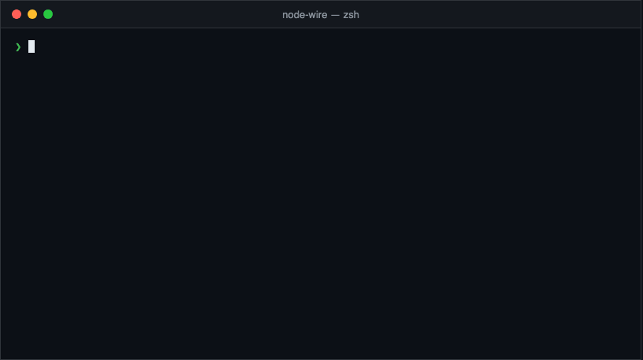

<!--
SPDX-FileCopyrightText: 2026 AOT Technologies

SPDX-License-Identifier: Apache-2.0
-->

# node wire

[](https://github.com/AOT-Technologies/node-wire/actions/workflows/pytest.yml)
[](https://github.com/AOT-Technologies/node-wire/actions/workflows/codeql.yml)
[](https://pypi.org/project/node-wire-runtime/)
[](https://github.com/AOT-Technologies/node-wire/releases/latest)
[](https://github.com/AOT-Technologies/node-wire/blob/main/LICENSE)

<p align="center">
  
</p>



**Node Wire is an open source Python connector framework.** You write or generate a connector once, and Node Wire runs it with the same validation, policy, resilience, error handling and telemetry, whether the caller is a web app over REST, a service over gRPC, or an AI agent over the Model Context Protocol (MCP).

Each connector is an adapter for one external system: Google Drive, SMTP, Stripe, FHIR, Salesforce, Slack, or any HTTP API with an OpenAPI spec. The runtime gives every action one execution contract and one response envelope, so a failure from Stripe and a failure from Salesforce reach the caller with the same shape and the same error categories.

## What it provides

Node Wire gives every connector the following:

- One connector contract served over REST (FastAPI), gRPC and MCP (stdio and streamable HTTP), with no transport code in the connector. See [Bindings](connector-bindings.md).
- A `run()` pipeline on every action: tenant pin check, Pydantic validation, scope policy, retries with a circuit breaker, and error mapping, all inside an OpenTelemetry span. See [Architecture](architecture.md#the-run-pipeline).
- A stable error taxonomy: every failure carries an `error_code` and one of `RETRYABLE`, `BUSINESS`, `AUTH` or `FATAL`. See [Errors](errors.md).
- Multi-tenancy with per-tenant named configs and secrets, resolved per request. See [Tenancy](architecture/tenancy.md).
- MCP features for AI agents: tenant and config selection tools, scope policy, and a [tool search mode](mcp.md#tool-search-mode) for connectors with hundreds of tools.
- Code generation from OpenAPI and Swagger specs with the [`nw` CLI](cli/index.md), plus `nw gen-stacklok` for ToolHive-ready MCP servers with an AI-curated tool set.

## Quick start

You need Python 3.11, 3.12 or 3.13 and [`uv`](https://docs.astral.sh/uv/). The [Installation guide](installation.md) covers the rest. To start the REST API locally, run the following commands:

```bash
git clone https://github.com/AOT-Technologies/node-wire.git
cd node-wire
uv sync --frozen --extra agents --dev
cp sample.env .env                  # set NW_ALLOWED_CONNECTORS, for example http_generic
export NW_REST_AUTH_DISABLED=true   # local dev only — otherwise /connectors/* and /ready return 503 until auth is configured
MODE=API uv run node-wire
```

Open [http://localhost:8000/docs](http://localhost:8000/docs) for the Swagger UI, or the [playground](http://localhost:8000/playground/) for interactive connector demos.

To generate a connector from an OpenAPI spec instead, use `nw gen-all`. The following recording shows a trial run on the Swagger Petstore spec:



## Where to start

<div class="grid cards" markdown>

-   **Run it**

    Install, configure the `NW_*` variables, and turn on multi-tenancy.

    [:octicons-arrow-right-24: Installation](installation.md) · [Configuration](configuration.md) · [Tenancy](architecture/tenancy.md)

-   **Call a connector**

    Use a shipped connector in-process or over REST, per tenant.

    [:octicons-arrow-right-24: Use a connector](connectors.md) · [Connector catalog](connector-reference.md#connector-catalog)

-   **Build or generate a connector**

    Write one by hand, or generate one from an OpenAPI spec with `nw`.

    [:octicons-arrow-right-24: Build a connector](connectors-build.md) · [CLI](cli/index.md)

-   **Deploy MCP**

    Expose connectors to AI agents: one process, per-connector images, or `nw gen-stacklok`.

    [:octicons-arrow-right-24: MCP overview](mcp.md#which-mcp-path)

</div>

New to the codebase? The [reading map](reading.md) gives the order: architecture, domain, seams, the `run()` pipeline, then topic branches. The reasons behind past decisions are in the [ADRs](adr/index.md).

Shipped connectors: Google Drive, Salesforce, Slack, SMTP, Stripe, FHIR Epic, FHIR Cerner and HTTP Generic. See the [catalog](connector-reference.md#connector-catalog).

## Contributing

Contributions are welcome. See the [Contributing guide](contributing.md) for development setup, quality checks, and DCO requirements, and [Changing the docs](reading.md#changing-the-docs) before you edit a page.
